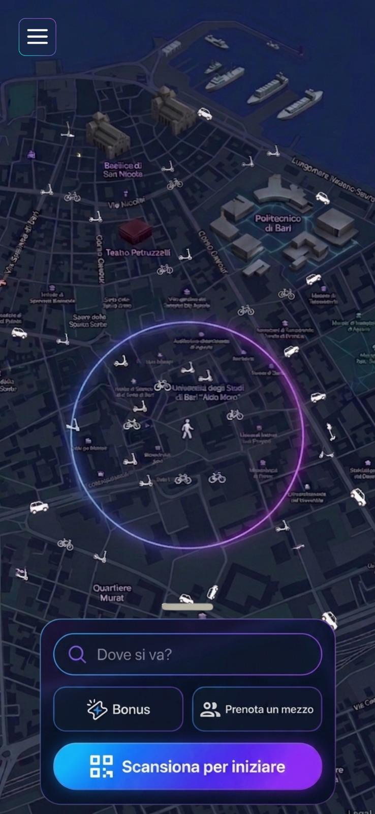
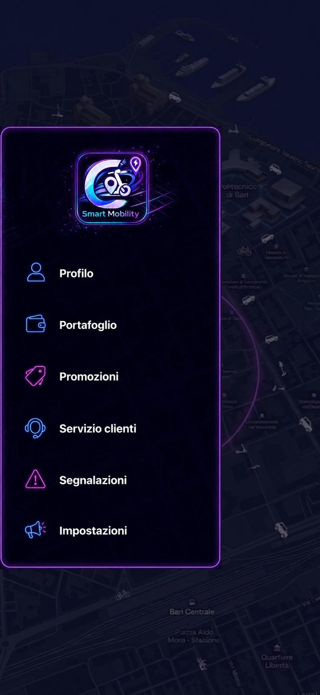
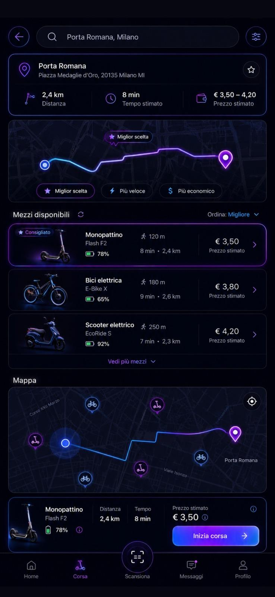
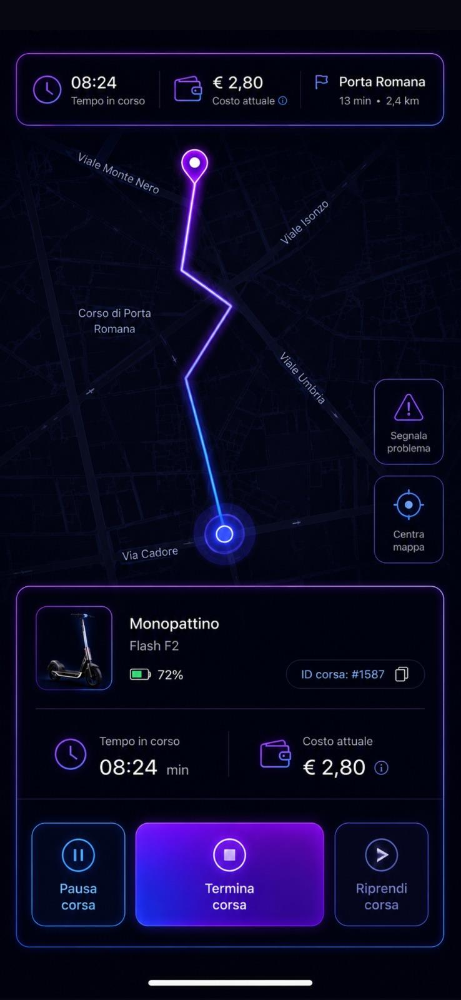
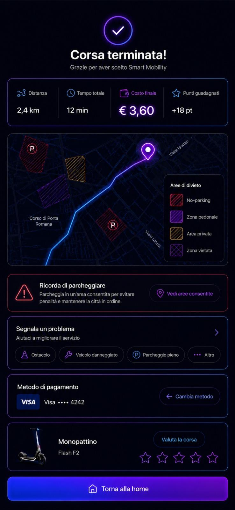

# 🛴 Smart Mobility — Gruppo C--

> MVP per il corso di **Ingegneria del Software** — A.A. 2025/2026
> Università degli Studi di Bari Aldo Moro — CdL ITPS

## Indice

1. [Nome e descrizione](#1-nome-e-descrizione)
2. [Gruppo](#2-gruppo)
3. [Dati](#3-dati)
4. [Funzionalità e ruoli](#4-funzionalità-e-ruoli)
5. [Architettura](#5-architettura)
6. [Come avviarla](#6-come-avviarla)
7. [Sviluppo con i coding agent](#7-sviluppo-con-i-coding-agent)
8. [Lavoro di gruppo](#8-lavoro-di-gruppo)
9. [Limiti noti](#9-limiti-noti)

---

## 1. Nome e descrizione

**Smart Mobility** è una piattaforma di **sharing della mobilità urbana** che integra bike sharing, car sharing ed e-scooter sharing in un'unica applicazione.

**Problema che risolve:** chi si sposta in città deve oggi usare app diverse per ogni tipo di mezzo, mentre chi gestisce il servizio e il Comune non hanno una vista unica su flotta, utilizzo e criticità. Smart Mobility mette nello stesso sistema:

- **Utenti** — cittadini che trovano, prenotano, sbloccano (QR code) e pagano un mezzo dall'app mobile;
- **Operatori del servizio** — gestiscono la flotta: tracciamento in tempo reale, malfunzionamenti, blocco remoto dei mezzi, blocco degli account, bonus;
- **Amministrazione pubblica** — monitora l'uso dei mezzi, le tratte più utilizzate, configura le aree con restrizioni e consulta report aggregati.

Il contesto è il **Comune di Zootropolis**, simulato sul territorio pugliese (Bari e altre città) per il prototipo.

---

## 2. Gruppo

**Gruppo C--**

| Membro | Account GitHub |
|---|---|
| Chiara Andriani | `chiara-andri` |
| Claudio Andriani | `ClaudeThePurrGrammer` |
| Vito Azzollini | `vito0522` |
| Mattia Campi | `mcampi2005-ai` |

---

## 3. Dati

- **Dataset:** **dati interamente inventati** dal gruppo (dati sintetici). Non è stato usato nessun dataset esterno e non ci sono dati personali reali.
- **Fonte / link:** il dataset è definito nel codice, in [`backend/app/seed.py`](backend/app/seed.py).
- **Licenza:** dati creati dal gruppo, nessuna licenza di terze parti.
- **Contenuto del seed:**
  - **70 aree di parcheggio** in 12 città pugliesi (Bari, Foggia, Lecce, Taranto, Molfetta, Barletta, Andria, Brindisi, Altamura, Manfredonia, Trani, Cerignola). Nomi e capienze sono inventati; le coordinate sono approssimate su vie e piazze pubbliche;
  - **60 veicoli** (monopattini, bici, auto elettriche) parcheggiati nelle aree di Bari, con batteria e tariffe inventate;
  - **3 account demo** (utente, operatore, amministrazione) con nomi, email e telefoni inventati, e con storico corse, promozioni e messaggi fittizi.
- **Come vengono importati:** non serve nessun import manuale. All'avvio del backend (`backend/app/main.py`) vengono eseguite in automatico le funzioni `seed()` ed `ensure_parking_areas()`, che popolano il database PostgreSQL se è vuoto. Per ripartire da zero vedi [Reset del database](#reset-del-database).
- **Servizi esterni (non sono dataset):** la ricerca indirizzi usa **OpenStreetMap Nominatim** e il calcolo dei percorsi usa il **server demo OSRM**. Sono interrogati a runtime, senza chiave API (dati © OpenStreetMap contributors, licenza ODbL).

---

## 4. Funzionalità e ruoli

### 4.1 Ruoli utente

Il ruolo è salvato nel campo `role` del modello `User` (`UTENTE`, `OPERATORE`, `AMMINISTRAZIONE`) e viene letto dal token JWT al login, che mostra la sezione giusta dell'app.

| Ruolo | Dove lavora | Cosa può fare |
|---|---|---|
| **Utente** | App mobile — `mobile/app/(app)/` | Mappa dei mezzi, prenotazione, sblocco con QR, corsa con pausa, fine corsa e pagamento, ricerca destinazione e stima costo, promozioni e punti fedeltà, wallet, segnalazioni, chat con l'assistenza |
| **Operatore** | App mobile — `mobile/app/(operatore)/` · Dashboard web — `VistaOperatore` | Tracciamento in tempo reale (WebSocket), disponibilità delle aree, malfunzionamenti, mezzi a fine corsa, blocco remoto dei mezzi, blocco/sospensione degli account, chiusura segnalazioni, assegnazione bonus |
| **Amministrazione pubblica** | App mobile — `mobile/app/(admin)/` · Dashboard web — `VistaAmministrazione` | Monitoraggio dell'uso dei mezzi, tratte più utilizzate, aree con restrizioni, segnalazione di zone/manutenzioni urbane, report aggregati sulla mobilità |

### 4.2 Screenshot

Le immagini seguenti sono i **mockup degli item di interfaccia** dell'app utente, presi dalla documentazione di progetto (`Documentazione Sorgente/`, §1.5.2 "Item di interfaccia"). Sono il riferimento grafico su cui è stata costruita l'app mobile, **non** catture dell'app in esecuzione. I file si trovano in [`docs/screenshots/`](docs/screenshots/).

<table>
<tr>
<td align="center"><br><sub>Login</sub></td>
<td align="center"><br><sub>Home (mappa mezzi)</sub></td>
<td align="center"><br><sub>Menù</sub></td>
<td align="center"><br><sub>Pagamento</sub></td>
</tr>
<tr>
<td align="center"><br><sub>Ricerca destinazione</sub></td>
<td align="center"><br><sub>Corsa attiva</sub></td>
<td align="center"><br><sub>Fine corsa</sub></td>
</tr>
</table>

### 4.3 Product Backlog — Item Funzionali

La documentazione (v6.0) specifica **35 Item Funzionali** distribuiti su tre ruoli. La tabella seguente mostra il grado di implementazione nel codice.

##### Utenti (UT.01 – UT.18)

| ID | Titolo | Stato | Componente implementato |
|---|---|---|---|
| UT.01 | Visualizzazione mappa mezzi disponibili | ✅ Implementato | `(app)/index.tsx` · `vehicles.py` |
| UT.02 | Prenotazione di un mezzo | ✅ Implementato | `(app)/reserve.tsx` · `(app)/active-reservation.tsx` · `reservations.py` |
| UT.03 | Ricerca destinazione | ✅ Implementato | `(app)/search.tsx` · `geo.py` (Nominatim) |
| UT.04 | Stima del costo del viaggio | ✅ Implementato | `(app)/search.tsx` (calcolo client-side su distanza) |
| UT.05 | Termine corsa | ✅ Implementato | `(app)/end-ride.tsx` · `rides.py` |
| UT.06 | Percorso ottimale in tempo reale | ✅ Implementato | `(app)/search.tsx` · `(app)/active-ride.tsx` (OSRM routing) |
| UT.07 | Suggerimento mezzo più adatto | ✅ Implementato | `(app)/search.tsx` (filtro autonomia + distanza) |
| UT.08 | Visualizzazione e applicazione promozioni | ✅ Implementato | `(app)/promotions.tsx` · `promotions.py` |
| UT.09 | Chat con il servizio clienti | ✅ Implementato | `(app)/chat-support.tsx` · `(app)/support.tsx` · `messages.py` |
| UT.10 | Login nel profilo | ✅ Implementato | `(auth)/login.tsx` · `auth.py` (JWT) |
| UT.11 | Visualizzazione stato di carica | ✅ Implementato | `(app)/index.tsx` (pannello dettaglio mezzo) · `vehicles.py` |
| UT.12 | Sblocco mezzo tramite QR code o app | ✅ Implementato | `(app)/scan.tsx` · `(app)/activate.tsx` · `vehicles.py` |
| UT.13 | Gestione metodo di pagamento | ✅ Implementato | `(app)/wallet.tsx` · `wallet.py` |
| UT.14 | Pausa corsa | ✅ Implementato | `(app)/active-ride.tsx` · `rides.py` (pausa con timer accumulato) |
| UT.15 | Creazione profilo utente | ✅ Implementato | `(auth)/register.tsx` · `auth.py` |
| UT.16 | Visualizzazione aree non accessibili | ✅ Implementato | `(app)/index.tsx` (overlay mappa) · `restrizioni.py` |
| UT.17 | Segnalazione problematiche percorso | ✅ Implementato | `(app)/report.tsx` · `(app)/reports-history.tsx` · `segnalazioni.py` |
| UT.18 | Pagamento corsa | ✅ Implementato | `(app)/ride-payment.tsx` · `(app)/payment-receipt.tsx` · `payment.py` |

##### Amministrazione Pubblica (AP.01 – AP.07)

| ID | Titolo | Stato | Componente implementato |
|---|---|---|---|
| AP.01 | Monitoraggio frequenza utilizzo mezzi | ✅ Implementato | `(admin)/monitoraggio.tsx` · `amministrazione.py` |
| AP.02 | Segnalazione manutenzioni urbane | ✅ Implementato | `(admin)/segnala-zona.tsx` · `(admin)/segna-zona.tsx` |
| AP.03 | Tratte più utilizzate | ✅ Implementato | `(admin)/tratte-piu-utilizzate.tsx` · `amministrazione.py` |
| AP.04 | Configurazione aree con restrizioni | ✅ Implementato | `(admin)/inserisci-area-restrizione.tsx` · `restrizioni.py` |
| AP.05 | Report aggregati sulla mobilità | ✅ Implementato | `(admin)/report-mobilita.tsx` · `amministrazione.py` |
| AP.06 | Registrazione Amministrazione | ✅ Implementato | `(auth)/register.tsx` (role=AMMINISTRAZIONE) · `auth.py` |
| AP.07 | Login Amministrazione | ✅ Implementato | `(auth)/login.tsx` · `auth.py` (ruolo rilevato da JWT) |

##### Operatore del Servizio (OP.01 – OP.10)

| ID | Titolo | Stato | Componente implementato |
|---|---|---|---|
| OP.01 | Registrazione Operatore | ✅ Implementato | `(auth)/register.tsx` (role=OPERATORE) · `auth.py` |
| OP.02 | Notifiche aree a diversa disponibilità | ✅ Implementato | `(operatore)/disponibilita-aree.tsx` · `operatore.py` (soglie VUOTA/CRITICA/OK/PIENA) |
| OP.03 | Conoscenza malfunzionamenti mezzi | ✅ Implementato | `(operatore)/malfunzionamenti-mezzi.tsx` · `segnalazioni.py` |
| OP.04 | Posizione mezzo a fine corsa | ✅ Implementato | `(operatore)/mezzi-fine-corsa.tsx` · `operatore.py` |
| OP.05 | Tracciamento posizione in tempo reale | ✅ Implementato | `(operatore)/tracciamento-mezzi.tsx` · `realtime.py` (WebSocket) |
| OP.06 | Chiusura segnalazione | ✅ Implementato | `(operatore)/chiudi-segnalazioni.tsx` · `(operatore)/segnalazione-dettaglio.tsx` · `segnalazioni.py` |
| OP.07 | Assegnazione automatica bonus | ✅ Implementato | `(operatore)/assegna-bonus.tsx` · `operatore.py` |
| OP.08 | Sospensione o blocco account utente | ✅ Implementato | `(operatore)/blocco-utenti.tsx` · `operatore.py` (auto-logout su account bloccato) |
| OP.09 | Blocco remoto mezzo | ✅ Implementato | `(operatore)/blocco-remoto.tsx` · `operatore.py` (`locked=True/False`) |
| OP.10 | Login Operatore | ✅ Implementato | `(auth)/login.tsx` · `auth.py` (ruolo OPERATORE da JWT) |

> **Copertura totale: 35/35 Item Funzionali implementati (100%)**

---

### 4.4 Use Cases (CU-01 → CU-35)

La documentazione specifica 35 casi d'uso con sequenze principali, sequenze alternative e pre/post-condizioni. La tabella seguente mappa ogni CU ai moduli implementati.

| CU | Nome | Attori | Implementazione |
|---|---|---|---|
| **CU-01** | Creazione profilo utente | Utente | `register.tsx` → `POST /auth/register` |
| **CU-02** | Visualizzazione mappa mezzi disponibili | Utente, Maps API | `index.tsx` → `GET /vehicles` (spawn-near-user logic) |
| **CU-03** | Prenotazione di un mezzo | Utente | `reserve.tsx` → `POST /reservations` · timer scadenza |
| **CU-04** | Sblocco mezzo tramite QR code o app | Utente | `scan.tsx` + `activate.tsx` → `POST /vehicles/{id}/unlock` |
| **CU-05** | Termine corsa e visualizzazione costo | Utente, Maps API | `end-ride.tsx` → `POST /rides/{id}/end` · verifica area parcheggio |
| **CU-06** | Cerca destinazione | Utente, Maps API | `search.tsx` → `GET /geo/search` (Nominatim autocomplete) |
| **CU-07** | Calcola stima costo | Utente, Maps API | `search.tsx` (calcolo client-side distanza × tariffa/km) |
| **CU-08** | Percorso più veloce in real time | Utente, Maps API | `search.tsx` + `active-ride.tsx` → OSRM routing API |
| **CU-09** | Visualizza mezzo idoneo | Utente | `search.tsx` (filtro autonomia vs distanza stimata) |
| **CU-10** | Visualizzazione e applicazione promozioni | Utente | `promotions.tsx` → `GET /promotions` · applicazione a corsa |
| **CU-11** | Chat con il servizio clienti | Utente | `chat-support.tsx` → `GET/POST /messages` |
| **CU-12** | Login utente | Utente | `login.tsx` → `POST /auth/login` (JWT) |
| **CU-13** | Visualizzazione stato di carica | Utente | `index.tsx` (pannello dettaglio mezzo, campo `battery_level`) |
| **CU-14** | Pausa corsa | Utente | `active-ride.tsx` → `POST /rides/{id}/pause` · `POST /rides/{id}/resume` |
| **CU-15** | Gestione metodo di pagamento | Utente | `wallet.tsx` → `GET/POST/DELETE /wallet/cards` |
| **CU-16** | Visualizzazione aree non accessibili | Utente | `index.tsx` (overlay poligoni) → `GET /restrizioni` |
| **CU-17** | Segnalazione problematiche percorso | Utente | `report.tsx` → `POST /segnalazioni` · `reports-history.tsx` |
| **CU-18** | Pagamento corsa | Utente | `ride-payment.tsx` → `POST /payment/ride` · `payment-receipt.tsx` |
| **CU-19** | Monitoraggio frequenza utilizzo mezzi | Amministrazione | `(admin)/monitoraggio.tsx` → `GET /amministrazione/stats` |
| **CU-20** | Segnalazione manutenzioni urbane | Amministrazione | `(admin)/segnala-zona.tsx` · `(admin)/segna-zona.tsx` |
| **CU-21** | Tratte più utilizzate | Amministrazione | `(admin)/tratte-piu-utilizzate.tsx` → `GET /amministrazione/tratte` |
| **CU-22** | Configurazione aree con restrizioni | Amministrazione | `(admin)/inserisci-area-restrizione.tsx` → `POST /restrizioni` |
| **CU-23** | Report aggregati sulla mobilità | Amministrazione | `(admin)/report-mobilita.tsx` → `GET /amministrazione/report` |
| **CU-24** | Registrazione Amministrazione Pubblica | Amministrazione | `register.tsx` (role=AMMINISTRAZIONE) → `POST /auth/register` |
| **CU-25** | Login Amministrazione Pubblica | Amministrazione | `login.tsx` → `POST /auth/login` (role check JWT) |
| **CU-26** | Registrazione Operatore | Operatore | `register.tsx` (role=OPERATORE) → `POST /auth/register` |
| **CU-27** | Login Operatore | Operatore | `login.tsx` → `POST /auth/login` (role check JWT) |
| **CU-28** | Blocco remoto mezzo | Operatore | `(operatore)/blocco-remoto.tsx` → `POST /operatore/mezzi/{id}/blocco` + `VistaOperatore.tsx` |
| **CU-29** | Notifiche aree a diversa disponibilità | Operatore | `(operatore)/disponibilita-aree.tsx` → `GET /operatore/aree-densita` (VUOTA/CRITICA/OK/PIENA) |
| **CU-30** | Conoscenza malfunzionamenti mezzi | Operatore | `(operatore)/malfunzionamenti-mezzi.tsx` → `GET /segnalazioni` (filtro stato=aperta) |
| **CU-31** | Posizione mezzo a fine corsa | Operatore | `(operatore)/mezzi-fine-corsa.tsx` → `GET /operatore/mezzi-rilascio` |
| **CU-32** | Tracciamento posizione in tempo reale | Operatore | `(operatore)/tracciamento-mezzi.tsx` → WebSocket `/realtime/ws` |
| **CU-33** | Chiusura segnalazione | Operatore | `(operatore)/chiudi-segnalazioni.tsx` → `PATCH /segnalazioni/{id}` (stato=chiusa) |
| **CU-34** | Assegnazione automatica bonus | Operatore | `(operatore)/assegna-bonus.tsx` → `POST /operatore/bonus` |
| **CU-35** | Sospensione o blocco account utente | Operatore | `(operatore)/blocco-utenti.tsx` → `PATCH /operatore/utenti/{id}/stato` · auto-logout 403 |

> **Copertura Use Cases: 35/35 (100%)**

##### Note sull'implementazione

- **Spawn-near-user logic (CU-02):** se l'utente ha meno di 12 veicoli entro ~1,2 km, il sistema sposta automaticamente veicoli parcheggiati nelle 8 aree di parcheggio più vicine all'utente.
- **Auto-logout su blocco account (CU-35):** il backend risponde HTTP 403 quando un utente bloccato/sospeso fa qualsiasi richiesta autenticata. Il client mobile intercetta globalmente il 403 ed esegue il logout immediato.
- **Disponibilità Aree (CU-29):** soglie — `0 veicoli = VUOTA 🔴`, `1-2 = CRITICA 🟡`, `3-5 = OK 🟢`, `≥6 = PIENA 🔵`.
- **Blocco remoto mezzo (CU-28):** i veicoli bloccati (`locked=True`) sono esclusi dalla mappa utenti ma visibili all'operatore nella sezione "Mezzi a fine corsa".
- **WebSocket real-time (CU-32):** aggiornamento continuo della posizione dei mezzi in corsa tramite `/realtime/ws`.

---

## 5. Architettura

Il sistema segue il pattern **MVC (Model-View-Controller)** su tre livelli distinti:

```
┌──────────────────────────────────────────────────────────────┐
│                          VIEW                                │
│  ┌──────────────────┐  ┌───────────────────────────────────┐ │
│  │  VistaUtente     │  │  VistaOperatore / VistaAmm.       │ │
│  │  (React Native / │  │  (React + Vite, porta 5173)       │ │
│  │   Expo SDK 54)   │  │  FormAutenticazione               │ │
│  │                  │  │  ComponenteMappa                  │ │
│  └────────┬─────────┘  └────────────┬──────────────────────┘ │
└───────────┼────────────────────────┼───────────────────────--┘
            │  REST API / WebSocket  │
┌───────────┼────────────────────────┼────────────────────────┐
│           ▼       CONTROLLER       ▼                        │
│  FastAPI (Python 3.12) — porta 8000                         │
│  GestioneMezzi · GestionePrenotazioni · GestioneCorsa       │
│  GestionePagamenti · GestioneUtenti · GestioneSegnalazioni  │
│  GestioneOperatore · GestioneAmministrazione                │
│  GestioneRestrizioni · GestionePercorsi · GestioneRealtà    │
└─────────────────────────┬───────────────────────────────────┘
                          │  SQLAlchemy ORM
┌─────────────────────────▼────────────────────────────────---┐
│                        MODEL                                │
│  PostgreSQL 16 — tabelle: Utente, Mezzo, Prenotazione,      │
│  Pagamento, Percorso, Corsa, Segnalazione, Promozione,      │
│  AreaRestrizione, Operatore, AmministrazionePubblica,       │
│  Mezzo_AreaRestrizione                                      │
└─────────────────────────────────────────────────────────────┘
```

**Interfacce esterne:** Maps API (Nominatim + OSRM), Payments Provider (simulato).

### 5.1 Stack tecnologico

| Livello | Tecnologia |
|---|---|
| **Mobile (VIEW Utente)** | React Native 0.81 · Expo SDK 54 · TypeScript · Expo Router v6 (file-based routing) |
| **Dashboard (VIEW Op./Amm.)** | React 19 · Vite 6 · TypeScript · Porta 5173 |
| **Backend (CONTROLLER)** | Python 3.12 · FastAPI · SQLAlchemy 2 · Pydantic v2 · Uvicorn |
| **Database (MODEL)** | PostgreSQL 16 |
| **Real-time** | WebSocket (FastAPI WebSocket router) |
| **Autenticazione** | JWT (python-jose) · SecureStore (mobile) |
| **Mappe** | react-native-maps · Nominatim (geocoding) · OSRM (routing) |
| **Container** | Docker + Docker Compose |
| **Versioning** | SVN su Redmine (fase di progettazione e prima consegna) · Git/GitHub (MVP) |

### 5.2 API esterne

| Servizio | Uso | Chiave |
|---|---|---|
| OpenStreetMap Nominatim | Ricerca indirizzi / geocoding (`routers/geo.py`, `routers/amministrazione.py`) | Non serve |
| OSRM (server demo) | Calcolo del percorso (`routers/geo.py`) | Non serve |
| Google / Facebook OAuth | Login social (**opzionale**) | Solo se si vuole attivarlo, vedi variabili d'ambiente |
| Provider di pagamento | **Simulato**: nessun pagamento reale | — |

### 5.3 Struttura delle cartelle

```
Smart_Mobility_SERLAB/
├── backend/
│   ├── app/
│   │   ├── main.py              # FastAPI app, lifespan, CORS, router registration
│   │   ├── models.py            # SQLAlchemy ORM models (MODEL layer)
│   │   ├── schemas.py           # Pydantic request/response schemas
│   │   ├── database.py          # Engine, SessionLocal, wait_for_db
│   │   ├── deps.py              # get_current_user, require_role
│   │   ├── security.py          # JWT encode/decode, password hashing
│   │   ├── seed.py              # Seed: 60 veicoli, 70 aree in 12 città, utenti demo
│   │   └── routers/
│   │       ├── auth.py          # Registrazione, login, JWT
│   │       ├── users.py         # Profilo utente, impostazioni
│   │       ├── vehicles.py      # Flotta, sblocco, spawn-near-user
│   │       ├── rides.py         # Corsa, pausa, fine corsa
│   │       ├── reservations.py  # Prenotazioni con timer scadenza
│   │       ├── parking.py       # Aree di parcheggio
│   │       ├── payment.py       # Pagamenti corsa
│   │       ├── wallet.py        # Metodi di pagamento utente
│   │       ├── promotions.py    # Promozioni e coupon
│   │       ├── messages.py      # Chat supporto clienti
│   │       ├── segnalazioni.py  # Segnalazioni utenti/admin
│   │       ├── restrizioni.py   # Aree di restrizione
│   │       ├── geo.py           # Geocoding (Nominatim)
│   │       ├── reports.py       # Report corsa
│   │       ├── operatore.py     # Funzionalità operatore (blocchi, aree, bonus)
│   │       ├── amministrazione.py # Funzionalità amministrazione
│   │       └── realtime.py      # WebSocket tracciamento real-time
│   └── Dockerfile
├── mobile/
│   └── app/
│       ├── (auth)/              # Login, Register, Forgot Password
│       ├── (app)/               # Schermate utente principale
│       ├── (operatore)/         # Schermate operatore
│       └── (admin)/             # Schermate amministrazione
├── dashboard/
│   └── src/
│       ├── pages/
│       │   ├── VistaOperatore.tsx
│       │   ├── VistaAmministrazione.tsx
│       │   └── FormAutenticazione.tsx
│       └── components/
│           ├── ComponenteMappa.tsx
│           └── Layout.tsx
└── docker-compose.yml
```

Altri file in root: `docker-compose.yml` (servizi `db`, `backend`, `dashboard`, `mobile`), `genera_qr_mezzi.py` (genera i QR code dei mezzi, vedi `Documentazione Sorgente/qr_mezzi.pdf`), `.github/workflows/ios-build.yml` (build iOS manuale su GitHub Actions), `Documentazione Sorgente/` (documentazione di progetto in PDF).

---

## 6. Come avviarla

### Requisiti

- [Docker Desktop](https://www.docker.com/products/docker-desktop/) con Docker Compose v2
- [Node.js 20+](https://nodejs.org/) e npm (per l'app mobile)
- [Expo Go](https://expo.dev/go) su uno smartphone iOS o Android, **sulla stessa rete Wi-Fi del PC**

### Installazione

#### Passo 1 — Clona il repository

```bash
git clone https://github.com/ClaudeThePurrGrammer/Smart_Mobility_SERLAB.git
cd Smart_Mobility_SERLAB
```

### Variabili d'ambiente

I file `.env` **non sono nel repository** (sono esclusi dal `.gitignore`). Si creano copiando gli esempi:

```bash
cp .env.example .env
cp mobile/.env.example mobile/.env    # opzionale
```

**`.env` (root)** — usato da `docker-compose.yml`

| Variabile | Obbligatoria | Descrizione |
|---|---|---|
| `HOST_IP` | Sì (per Expo Go) | IP locale del PC, es. `192.168.1.10` (`ipconfig` su Windows, `ifconfig` / `ip a` su macOS/Linux) |
| `JWT_SECRET` | Sì | Segreto per firmare i token JWT: scegliete una stringa qualsiasi |
| `GOOGLE_CLIENT_ID` | No | Solo per attivare il login Google reale |
| `FACEBOOK_APP_ID`, `FACEBOOK_APP_SECRET` | No | Solo per attivare il login Facebook reale |

**`mobile/.env`** — opzionale

| Variabile | Descrizione |
|---|---|
| `EXPO_PUBLIC_API_URL` | Da impostare solo se il backend non gira sul PC locale (di default l'app lo trova da sola sulla porta 8000) |
| `EXPO_PUBLIC_GOOGLE_IOS_CLIENT_ID`, `EXPO_PUBLIC_GOOGLE_ANDROID_CLIENT_ID`, `EXPO_PUBLIC_GOOGLE_WEB_CLIENT_ID`, `EXPO_PUBLIC_FACEBOOK_APP_ID` | Solo per il login social |

### Avvio

#### Passo 2 — Avvia il Backend (API + Database)

```bash
docker compose up --build backend db -d
```

Il backend sarà disponibile su `http://localhost:8000`. La documentazione API interattiva è su `http://localhost:8000/docs`.

> Al primo avvio il database viene popolato automaticamente con 60 veicoli, 70 aree di parcheggio (vedi [Dati](#3-dati)), e gli account demo.

#### Passo 3 — Avvia la Dashboard Web (Operatore / Amministrazione)

```bash
docker compose up --build dashboard -d
```

La dashboard è disponibile su `http://localhost:5173`.

#### Passo 4 — Avvia l'App Mobile

L'app mobile viene avviata **fuori da Docker** per compatibilità con Expo Go:

```bash
cd mobile
npm install
npx expo start --lan --clear
```

Scansiona il QR code con **Expo Go** (Android) o con la fotocamera (iOS).

> Assicurati che il dispositivo mobile e il PC siano sulla **stessa rete Wi-Fi**.

#### Riepilogo servizi

| Servizio | URL | Note |
|---|---|---|
| Backend API | `http://localhost:8000` | |
| Swagger UI | `http://localhost:8000/docs` | Documentazione interattiva |
| Dashboard | `http://localhost:5173` | Login con account operatore/amm. |
| App Mobile | QR code nel terminale | Expo Go |

### Reset del database

Per cancellare tutti i dati e rieseguire il seed:

```bash
docker compose down -v
docker compose up --build backend db -d
```

### Utenti di prova (inventati)

Vengono creati in automatico dal seed (`backend/app/seed.py`):

| Ruolo | Email | Password |
|---|---|---|
| Utente | `utente@smartmobility.it` | `password123` |
| Operatore | `operatore@smartmobility.it` | `password123` |
| Amministrazione | `amministrazione@smartmobility.it` | `password123` |

> ⚠️ Sono account fittizi, validi solo in sviluppo.

### Test

Al momento **non ci sono test automatici** nel repository (vedi [Limiti noti](#9-limiti-noti)). Gli endpoint si possono provare a mano dalla Swagger UI su `http://localhost:8000/docs`, usando gli utenti di prova qui sopra.

---

## 7. Sviluppo con i coding agent

- **Agent usati:** **Claude Desktop** e **Claude Code** (Anthropic).
- **Modelli:** **Claude Opus** e **Claude Sonnet**, in genere con effort di ragionamento **High / Max**.
- **Approccio:** modalità **automatica**: l'agent applica le modifiche ai file in autonomia e, in alcuni casi, chiede conferma prima di eseguire comandi da terminale.
- **Prompt di lavoro:** il file [`PROMPT_CLAUDECODE.md`](PROMPT_CLAUDECODE.md) contiene il prompt dato a Claude Code dopo una revisione del codice (stato al 22-06-2026). Elenca 6 fix puntuali con file, problema e soluzione attesa (compatibilità schema, seed dei veicoli, recupero password, link Termini/Privacy, pannello dettaglio mezzo, spawn dei veicoli vicino all'utente), una tabella di priorità e la lista delle parti da **non** modificare.
- **AGENTS.md / CLAUDE.md:** non presenti nel repository; il contesto all'agent è stato dato tramite `PROMPT_CLAUDECODE.md`.
- **Skill:** nessuna skill personalizzata (nel repository non ci sono cartelle `.claude/` né file `SKILL.md`).
- **Riservatezza:** `.claude/settings.local.json` e i file `.env` sono esclusi dal `.gitignore`.

---

## 8. Lavoro di gruppo

Il progetto è stato gestito con **Scrum su Redmine** (3 sprint, dal 6 maggio al 28 giugno 2026; 205 attività, tutte chiuse). La progettazione è stata divisa **per user story**: ogni membro ha preso un gruppo di user story e, per ciascuna, ha curato specifica del caso d'uso, diagramma di sequenza e revisioni. Il codice della prima fase è stato versionato su **SVN** (TortoiseSVN, collegato a Redmine) e poi importato su GitHub.

| Membro | Attività su Redmine (assegnate) | Responsabilità principali |
|---|---|---|
| **Chiara Andriani** | 46 | User Stories aggiornate, glossario e item non funzionali; casi d'uso UC-16 → UC-23 e UC-26 (US 16, 17, AP.01 → AP.06, OP-02); diagramma dei casi d'uso (versione definitiva in Visual Paradigm); struttura fisica del database. Codice: parte amministrazione e operatore (branch `operator-admin`) |
| **Claudio Andriani** | 40 | Diagramma delle componenti (iniziale e definitivo); casi d'uso UC-11 → UC-15 e UC-32 → UC-34 (US 09, 10, 11, 13, 14, OP-08 → OP-10); Sprint Backlog e refinement dello sprint 1; pubblicazione della prima versione del frontend (7/06) e consegna definitiva del codice su SVN (28/06); import su GitHub e integrazione dei branch |
| **Vito Azzollini** | 44 | Product Backlog iniziale e refinement dello sprint 2; UI del sistema; casi d'uso UC-01 → UC-05, UC-25, UC-27, UC-28 (US 15, 01, 02, 12, 05, OP-01, OP-03, OP-04); diagramma delle classi (View / Controller / Model, sprint 1 e 2); modello logico del DB; report degli sprint 2 e 3. Codice: aggiornamento del 26/06 |
| **Mattia Campi** | 46 | Refinement del Product Backlog per lo sprint 0; casi d'uso UC-06 → UC-10, UC-24, UC-29 → UC-31 (US 03, 04, 06, 07, 08, AP-07, OP-05 → OP-07); revisione dei diagrammi di sequenza; diagramma delle classi definitivo; report dello sprint 1 |

Fonte: export CSV delle attività Redmine e storico Git.

### Branch e pull request

| Branch | Contenuto |
|---|---|
| `main` | Versione integrata dell'MVP |
| `user-side` | Branch per il lato utente: non contiene commit che non siano già in `main` |
| `operator-admin` | Lato operatore e amministrazione (commit di Chiara Andriani) |

Il branch `operator-admin` è stato integrato in `main` **a mano** (commit `cc9fdd4`, "merge: integrazione operator/admin da branch colleghi"), non con una pull request, perché la prima fase del lavoro era su SVN. Dall'MVP in poi le modifiche passano da pull request:

| Branch | Descrizione della pull request |
|---|---|
| `docs/readme-mvp` → `main` | README dell'MVP secondo la traccia di consegna, dati demo resi fittizi nel seed, mockup dell'interfaccia in `docs/screenshots/` |

---

## 9. Limiti noti

- **Nessun test automatico** (né `pytest` per il backend né test per mobile/dashboard).
- **Pagamenti simulati:** wallet e pagamento corsa non sono collegati a un provider reale.
- **Recupero password dimostrativo:** `POST /auth/forgot-password` risponde sempre OK ma non invia email.
- **Login social** (Google/Facebook) funziona davvero solo se si configurano le credenziali OAuth nei `.env`.
- **Dipendenza da servizi pubblici gratuiti:** Nominatim e il server demo OSRM hanno limiti di utilizzo; se non rispondono, ricerca e percorsi non funzionano.
- **App mobile solo in sviluppo con Expo Go:** telefono e PC devono stare sulla stessa rete Wi-Fi; non esiste una build pubblicata sugli store.
- **Credenziali del database di sviluppo** scritte in chiaro in `docker-compose.yml` (`POSTGRES_PASSWORD`): vanno bene solo in locale.
- **Link "Termini di servizio"** dell'app puntano a un URL di esempio, non a una pagina reale.
- **Screenshot:** nel README ci sono i mockup di progetto, non catture dell'app in esecuzione.
- **Dati solo sintetici:** posizioni dei mezzi e storico corse non vengono da una flotta reale.

---

<div align="center">

*Progetto realizzato per il corso di Ingegneria del Software — A.A. 2025/2026*
*Università degli Studi di Bari Aldo Moro*

**Andriani Chiara · Andriani Claudio · Azzollini Vito · Campi Mattia**

</div>
